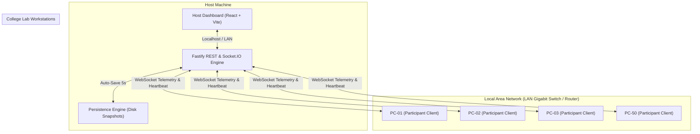
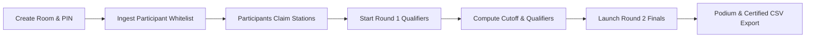

<div align="center">

# ⚡ BLITZKRIEG

**High-Performance, LAN-First Competitive Typing Tournament Platform for College Computer Laboratories**

[](https://opensource.org/licenses/MIT)
[](https://nodejs.org/)
[](https://react.dev/)
[](https://www.typescriptlang.org/)
[](https://fastify.dev/)
[](https://socket.io/)
[](CONTRIBUTING.md)

[Features](#-key-features) • [Host Guide](#-host-instructions--operator-manual) • [Quick Start](#-quick-start) • [Architecture](#-architecture) • [Contributing](CONTRIBUTING.md) • [License](LICENSE)

</div>

---

> [!TIP]
> **GitHub Repository About Settings**  
> If you are setting up the GitHub repository sidebar, you can copy-paste these recommended details:
> - **Description:** `LAN-first, offline-resilient competitive typing tournament platform with real-time host proctoring and zero-latency input.`
> - **Topics / Tags:** `typing-competition`, `lan-first`, `esports`, `react`, `fastify`, `socket-io`, `anti-cheat`, `proctoring`, `typescript`, `college-hackathon`

---

## 📖 Overview

**Blitzkrieg** is an esports-grade competitive typing tournament platform engineered specifically for college computer laboratories, hackathons, and offline gaming events. 

Standard online typing platforms struggle in controlled educational environments due to internet bandwidth constraints, erratic latency, inability to prevent tab-switching/cheating, and lack of host-centric tournament orchestration. Blitzkrieg resolves this with a **LAN-first architecture**:
- **Offline Resilient**: Runs on a local router or switch without requiring an active internet connection.
- **Sub-Millisecond Keystroke Latency**: Browser-native typing engine ensures contestants feel zero network lag.
- **Host as Sole Adjudicator**: Real-time administrative dashboard for 50+ concurrent lab stations, live proctoring, synchronized countdowns, station reassignment, and automated qualifier progression.

---

## ✨ Key Features

| Feature | Description |
| :--- | :--- |
| **🏎️ Zero-Latency Typing Engine** | Keystrokes are evaluated immediately on the client using sub-millisecond local event processing. |
| **📡 Real-Time Host Radar** | Fastify & Socket.IO telemetry grid streaming live WPM, accuracy %, progress, and station heartbeats. |
| **🛡️ Proactive Anti-Cheat Proctoring** | Automated detection of window blurs, tab switching, copy-pasting, and non-human cadence spikes. |
| **🏷️ Dynamic Station Auto-Binding** | Participants log in via registered email and room PIN; seats automatically bind to `PC-01` through `PC-50`. |
| **🏆 Two-Stage Tournament Progression** | Seamless qualifier cutoff calculations (Round 1) and instant room migration into the Championship finals (Round 2). |
| **💾 Zero-Data-Loss Persistence** | Background snapshot engine saves state every 5 seconds to disk with instant crash recovery. |
| **⚖️ Authoritative Tie-Breaking** | Strict programmatic tie-breaking hierarchy (Net WPM $\rightarrow$ Raw Accuracy $\rightarrow$ Error Count $\rightarrow$ Timestamp). |
| **📊 Certified Results Export** | Single-click export of complete tournament rankings, telemetry, and proctoring audit trails into CSV. |

---

## 🏛 Architecture

Blitzkrieg utilizes a decoupled, high-performance monorepo architecture designed for rapid local discovery and deterministic message broadcasting:



---

## 🚀 Quick Start

### Prerequisites
- **Node.js**: `v22.0.0` or later
- **npm**: `v10.0.0` or later
- **Modern Web Browser**: Google Chrome, Microsoft Edge, Brave, or Mozilla Firefox

### 1. Installation
Clone the repository and install all monorepo dependencies:

```bash
git clone https://github.com/ash-ftw/blitzkrieg.git
cd blitzkrieg
npm install
```

### 2. Configure Environment
```bash
cp .env.example .env
```

### 3. Launch Development Environment
Run both backend and frontend services simultaneously:

```bash
npm run dev
```

- **Frontend Application**: `http://localhost:5173`
- **Backend API & WebSockets**: `http://localhost:4000`

---

## 🎯 Host Instructions & Operator Manual

For the complete step-by-step tournament administration manual, refer to **[HOST_GUIDE.md](HOST_GUIDE.md)**.

### Quick Host Reference

#### 1. Host Authentication
- Access `http://localhost:5173` on the host machine and select **Host Login**.
- Default Authorized Host Credentials:
  - `max@host.com` / `host123`
  - `lec@host.com` / `host123`
  - `kimi@host.com` / `host123`
- Host sessions persist across server reboots.

#### 2. Lab LAN Deployment
1. Identify the host machine's local IPv4 address:
   - **Windows**: `ipconfig` (e.g. `192.168.1.50`)
   - **Linux / macOS**: `ip a` or `ifconfig`
2. Ensure inbound firewall access for ports `4000` and `5173`:
   ```powershell
   # Windows (Administrator PowerShell)
   New-NetFirewallRule -DisplayName "Blitzkrieg Ports" -Direction Inbound -LocalPort 4000,5173 -Protocol TCP -Action Allow
   ```
3. Open `http://<HOST_IP>:5173` on all lab client computers.

#### 3. Tournament Flow


---

## 💻 Available Scripts

| Script | Purpose |
| :--- | :--- |
| `npm run dev` | Starts backend and frontend concurrently with color-coded logging |
| `npm run dev:backend` | Starts only Fastify backend with `tsx` hot-reloading |
| `npm run dev:frontend` | Starts only Vite frontend bound to `0.0.0.0:5173` |
| `npm run build` | Compiles TypeScript shared packages, backend, and frontend bundles |
| `npm run typecheck` | Validates TypeScript types across all monorepo packages |
| `npm run lint` | Runs ESLint across all codebases |

---

## 📁 Repository Structure

```text
blitzkrieg/
├── apps/
│   ├── backend/               # Fastify + Socket.IO server
│   │   └── src/
│   │       ├── auditLog.ts       # Tamper-evident incident tracking
│   │       ├── auth.ts           # Host & participant token sessions
│   │       ├── contestEngine.ts  # Rules, scoring math, and round control
│   │       ├── index.ts          # Server entry & Socket.IO event handlers
│   │       ├── passages.ts       # Curated tournament text passages
│   │       ├── persistence.ts    # 5-second disk state serialization
│   │       ├── room.ts           # Dynamic room creation & PIN validation
│   │       └── stations.ts       # Lab computer mapping & heartbeat monitors
│   └── frontend/              # React 19 + TypeScript + Vite UI
│       └── src/
│           ├── App.tsx           # Host dashboard & participant race interface
│           ├── components/
│           │   ├── SystemCheck.tsx   # Pre-flight keyboard & latency tester
│           │   └── TypingEngine.tsx  # Low-latency browser keystroke tracker
│           └── styles.css        # Tailwind styling & dark tournament aesthetic
├── packages/
│   └── shared/                # Canonical TypeScript domain types & interfaces
├── scripts/
│   └── dev.mjs                # Concurrent multi-service process runner
├── docker-compose.yml         # Container definitions for auxiliary databases
├── HOST_GUIDE.md              # Complete Host & Operator Field Manual
├── CONTRIBUTING.md            # Guidelines for open-source contributors
├── CODE_OF_CONDUCT.md         # Contributor Covenant Code of Conduct
└── LICENSE                    # Open-source MIT License
```

---

## 🔒 Security & Privacy

Blitzkrieg is designed with strict data hygiene standards:
- **No Telemetry Leaks**: The system operates completely within your physical laboratory intranet. No participant data or typing metrics are ever transmitted to third-party cloud servers.
- **Ephemeral State Cleaning**: Runtime history snapshots and session records are excluded from git tracking (`.gitignore`) to safeguard student emails and performance scores.

---

## 🤝 Contributing

Contributions are warmly welcome! Whether you are interested in adding new typing metrics, designing custom UI themes, or writing passage collections, check out **[CONTRIBUTING.md](CONTRIBUTING.md)** to get started.

---

## 📄 License

This project is licensed under the **MIT License** — see the [LICENSE](LICENSE) file for details.
